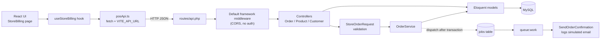

# Store Order & Inventory Mini-System

A small retail point-of-sale (POS) system: a **Laravel 12 REST API** that creates orders, calculates tax, deducts stock safely inside a database transaction, and queues a confirmation job, plus a **React + TypeScript** single-page billing screen that uses it.

## Table of Contents

1. [Project Overview](#1-project-overview)
2. [Feature Matrix](#2-feature-matrix)
3. [Technology Stack](#3-technology-stack)
4. [Repository Structure](#4-repository-structure)
5. [Architecture at a Glance](#5-architecture-at-a-glance)
6. [Database Summary](#6-database-summary)
7. [Core Workflows](#7-core-workflows)
8. [API Summary](#8-api-summary)
9. [Validation and Error Handling](#9-validation-and-error-handling)
10. [Design Decisions and Assumptions](#10-design-decisions-and-assumptions)
11. [Installation and Setup](#11-installation-and-setup)
12. [Testing](#12-testing)

---

## 1. Project Overview

### What it does

The application lets a shop operator bill a customer at the counter:

1. Enter the customer's email (and name, for a new customer).
2. Choose products and quantities from the live inventory.
3. See subtotal, tax, grand total and change due calculated on screen.
4. Click **Generate Bill**. The backend re-validates everything, locks the product rows, checks stock, stores the order, deducts inventory and queues a confirmation job.

A **Low Stock Alert** panel on the same screen lists products whose stock is below a configurable threshold.

### Business problems it addresses

### How the frontend and backend communicate

The React app calls the Laravel JSON API over HTTP using `fetch`. The base URL comes from `VITE_API_URL` (default `http://127.0.0.1:8000/api`). Laravel allows the frontend origin through CORS (`CORS_ALLOWED_ORIGINS`, default `http://localhost:5173`). All endpoints are in `routes/api.php`, so they are served under the `/api` prefix.

---

## 2. Feature Matrix

| Capability                                      | Status                            | Notes                                            |
| ----------------------------------------------- | --------------------------------- | ------------------------------------------------ |
| Create order (multi-line, with tax and change)  | Implemented                       | `POST /api/orders`                               |
| Customer create-or-reuse by email               | Implemented                       | `Customer::firstOrCreate` inside the transaction |
| Customer lookup (name autofill)                 | Implemented                       | `GET /api/customers/{email}`                     |
| Customer order history (paginated, 20 per page) | Implemented                       | `GET /api/customers/{email}/orders`              |
| Product listing for the order form              | Implemented                       | `GET /api/products` (not paginated)              |
| Low-stock listing with configurable threshold   | Implemented                       | `GET /api/products/low-stock`                    |
| Stock deduction in a transaction with row locks | Implemented                       | `OrderService::create()`                         |
| Queued order-confirmation job                   | Implemented (**simulated email**) | Writes a log line. No email is sent.             |
| Light/dark theme                                | Implemented                       | Frontend only, persisted in `localStorage`       |
| Responsive layout                               | Implemented                       | Bootstrap grid plus media queries in `style.css` |

---

## 3. Technology Stack

| Layer                   | Technology                                            | Version (verified)                                         |
| ----------------------- | ----------------------------------------------------- | ---------------------------------------------------------- |
| Backend framework       | Laravel                                               | 12.70.2 (`composer.lock`)                                  |
| Language (backend)      | PHP                                                   | `^8.2` required; verified on 8.3.6                         |
| Database (intended)     | MySQL                                                 | `.env.example` defaults to `mysql`, DB name `store_orders` |
| Database (tests)        | SQLite in memory                                      | `phpunit.xml`                                              |
| API style               | JSON REST, Laravel API Resources                      | `OrderResource`                                            |
| Auth                    | Laravel Sanctum installed, **not used**               | 4.3.3                                                      |
| Queue                   | Laravel queue, `database` driver                      | `QUEUE_CONNECTION=database`                                |
| Email                   | `log` mailer; job only logs a simulated email         | `MAIL_MAILER=log`                                          |
| Backend testing         | PHPUnit                                               | `^11.5.50`, run through `php artisan test`                 |
| Code style              | Laravel Pint                                          | `^1.24` (dev dependency)                                   |
| Frontend framework      | React                                                 | 19.3.1                                                     |
| Frontend language       | TypeScript                                            | 7.0.2                                                      |
| Build tool              | Vite with `@vitejs/plugin-react`                      | 8.3.5 / 6.1.2                                              |
| Routing                 | React Router DOM                                      | 7.18.5                                                     |
| UI                      | Bootstrap 5 and Bootstrap Icons, `lucide-react` icons | 5.3.8 / 1.64.0                                             |
| Server-state library    | TanStack React Query                                  | 5.105.0 (provider only)                                    |
| Linting                 | Oxlint                                                | 1.90.0                                                     |
| Frontend hosting config | `vercel.json` SPA rewrite                             |                                                            |
| Node.js                 | Vite 8 requires `^20.19.0                             | >=22.12.0` verified on 22.22.2                             |

---

## 4. Repository Structure

```text
store-orders/
├── backend/                         Laravel 12 API
│   ├── app/
│   │   ├── Exceptions/InsufficientStockException.php   renders its own 422 JSON
│   │   ├── Http/
│   │   │   ├── Controllers/Api/{Order,Product,Customer}Controller.php
│   │   │   ├── Requests/StoreOrderRequest.php
│   │   │   └── Resources/OrderResource.php
│   │   ├── Jobs/SendOrderConfirmation.php
│   │   ├── Models/{Customer,Order,OrderItem,Product,User}.php
│   │   └── Services/OrderService.php                   all order business logic
│   ├── config/inventory.php                            low_stock_threshold
│   ├── database/{migrations,factories,seeders}/
│   ├── routes/api.php                                  the only real route file
│   ├── scripts/concurrency-check.sh                    manual race-condition demo
│   └── tests/Feature/{CreateOrderTest,CustomerAndStockTest,ExampleTest}.php
└── frontend/                        React + TypeScript SPA
    └── src/
        ├── pages/admin/StoreBilling.tsx    the single page
        ├── components/{layout,pos}/        UI components
        ├── hooks/useStoreBilling.ts        all state and workflow logic
        ├── services/posApi.ts              fetch wrapper
        ├── utils/{currency,posValidation}.ts
        ├── types/pos.ts
        └── router/AppRoutes.tsx            one route: "/"
```

Not present in the backend: Events/Listeners, Notifications/Mailables, custom Middleware, Policies, API route versioning, a custom exception handler (`bootstrap/app.php` leaves middleware and exceptions at defaults).

---

## 5. Architecture at a Glance



---

## 6. Database Summary

Business tables (all in `2026_10_29_000001_create_store_tables.php`):

| Table         | Purpose                            | Key constraints                                                                      |
| ------------- | ---------------------------------- | ------------------------------------------------------------------------------------ |
| `products`    | Catalog and current stock          | `code` UNIQUE; `stock` unsigned int, indexed                                         |
| `customers`   | Buyers, identified by email        | `email` UNIQUE                                                                       |
| `orders`      | Order header and totals            | `number` UNIQUE; `customer_id` FK (restrict); index `(customer_id, created_at)`      |
| `order_items` | Line items with price/tax snapshot | `order_id` FK (cascade); `product_id` FK (restrict); UNIQUE `(order_id, product_id)` |

Framework tables also exist: `users`, `password_reset_tokens`, `sessions`, `cache`, `cache_locks`, `jobs`, `job_batches`, `failed_jobs`, `personal_access_tokens`.

---

## 7. Core Workflows

### Order creation (verified step by step)

| #   | Step                              | Where               | Actual behavior                                                                                                       |
| --- | --------------------------------- | ------------------- | --------------------------------------------------------------------------------------------------------------------- |
| 1   | Page loads                        | `useStoreBilling`   | Fetches `/products` and `/products/low-stock` in parallel.                                                            |
| 2   | User fills customer, rows, amount | Components          | Rows hold product and quantity. Client blocks duplicate products and quantity above displayed stock.                  |
| 3   | Client totals                     | `useStoreBilling`   | Integer paise; tax per line rounded; shows change and a denomination breakdown.                                       |
| 4   | `POST /api/orders`                | `posApi.ts`         | JSON body with `email`, `name`, `items[]`, `amount_given`.                                                            |
| 5   | Validation                        | `StoreOrderRequest` | Name is required only if the email is not already a customer.                                                         |
| 6   | Merge duplicate lines             | `OrderService`      | Quantities summed per product; ids sorted for consistent lock order.                                                  |
| 7   | Transaction begins                | `DB::transaction`   |                                                                                                                       |
| 8   | Lock and check stock              | `OrderService`      | `lockForUpdate()` on the product rows; any shortfall throws `InsufficientStockException` (HTTP 422 with `shortages`). |
| 9   | Compute totals                    | `OrderService`      | Integer paise; line tax = `round(lineSubtotal * tax% / 100)`.                                                         |
| 10  | Check payment                     | `OrderService`      | If `amount_given` is present and below the grand total → `ValidationException` (422).                                 |
| 11  | Deduct stock                      | `OrderService`      | Guarded `UPDATE ... WHERE stock >= qty` via `decrement`; a second safety net behind the lock.                         |
| 12  | Customer                          | `OrderService`      | `firstOrCreate` by email; default name is the part before `@`.                                                        |
| 13  | Persist                           | `OrderService`      | Order with generated number `ORD-` + 10 random uppercase characters, then `items()->createMany()`.                    |
| 14  | Commit, then dispatch             | `OrderService`      | `SendOrderConfirmation::dispatch($order)->afterCommit()` runs **after** the transaction closure returns.              |
| 15  | Response                          | `OrderController`   | `201 Created` with `OrderResource`.                                                                                   |
| 16  | UI                                | `useStoreBilling`   | Shows the bill, resets the form, refreshes inventory.                                                                 |

### Inventory

- **Available stock** is `products.stock`. There is no reservation or movement ledger.
- **Insufficient stock**: HTTP 422 with a `shortages` array; nothing is written.
- **Low stock**: `stock < threshold` (strictly below). The default is `LOW_STOCK_THRESHOLD=10` via `config/inventory.php`; `?threshold=N` overrides it.
- **Concurrency**: protected by pessimistic row locks, taken in ascending product-id order to avoid deadlocks, plus a conditional decrement. `scripts/concurrency-check.sh` is provided to demonstrate it on MySQL/PostgreSQL. SQLite ignores `FOR UPDATE`, so the automated tests do **not** exercise real locking.

### Queue and email

- `SendOrderConfirmation` implements `ShouldQueue`, has `$tries = 3` and `$backoff = [10, 60]`.
- It is dispatched after commit. Queue driver is `database`, so a row is inserted into `jobs`.
- `handle()` only calls `Log::info('Order confirmation email sent (simulated)', ...)`. **No email is composed or sent.** A successfully dispatched job therefore means "a log line will be written when a worker runs", not "a customer was emailed".
- If no worker is running, jobs wait in the `jobs` table. The order still succeeds. (Verified: after one order, `jobs` held one row; `php artisan queue:work --once` processed it.)
- Exhausted jobs are moved to `failed_jobs` (table exists). Inspect with `php artisan queue:failed`, retry with `php artisan queue:retry all`.
- Run the worker: `php artisan queue:work` (or `php artisan queue:listen --tries=1 --timeout=0` as used in `composer dev`).

---

## 8. API Summary

All routes are under `/api` and are **unauthenticated**. Confirmed with `php artisan route:list --path=api`.

| Method | Endpoint                        | Controller                   | Purpose                                           | Validation                            |
| ------ | ------------------------------- | ---------------------------- | ------------------------------------------------- | ------------------------------------- |
| POST   | `/api/orders`                   | `OrderController@store`      | Create an order, deduct stock, queue confirmation | `StoreOrderRequest`                   |
| GET    | `/api/products`                 | `ProductController@index`    | All products ordered by name                      | none                                  |
| GET    | `/api/products/low-stock`       | `ProductController@lowStock` | Products below threshold, lowest stock first      | `threshold`: nullable, integer, min 0 |
| GET    | `/api/customers/{email}`        | `CustomerController@show`    | Customer name and email, 404 if unknown           | none                                  |
| GET    | `/api/customers/{email}/orders` | `CustomerController@orders`  | Customer's orders, newest first, 20 per page      | none                                  |

---

## 9. Validation and Error Handling

`StoreOrderRequest` rules (exactly as in the code):

| Field                | Rules                                                                                          |
| -------------------- | ---------------------------------------------------------------------------------------------- |
| `email`              | `required`, `email:rfc`, `max:255`                                                             |
| `name`               | `required` if the email is not an existing customer, otherwise `nullable`; `string`, `max:255` |
| `items`              | `required`, `array`, `min:1`                                                                   |
| `items.*.product_id` | `required`, `integer`, `exists:products,id`                                                    |
| `items.*.quantity`   | `required`, `integer`, `min:1`, `max:100000`                                                   |
| `amount_given`       | `required`, `numeric`, `min:1`                                                                 |

| Situation                      | HTTP | Body                                                                     |
| ------------------------------ | ---- | ------------------------------------------------------------------------ |
| Field validation fails         | 422  | `{ "message", "errors": { field: [..] } }`                               |
| Insufficient stock             | 422  | `{ "message", "shortages": [{product_id, name, requested, available}] }` |
| Amount given below grand total | 422  | `errors.amount_given`                                                    |
| Unknown customer email         | 404  | Laravel default (`ModelNotFoundException`)                               |
| Order created                  | 201  | `{ "data": { ... } }`                                                    |

The whole order is wrapped in `DB::transaction`, so any exception rolls back stock, customer, order and items.

---

## 10. Design Decisions and Assumptions

### Verified implementation decisions

- **Service class** (`OrderService`) owns the business rules; controllers are three lines long and testable seams exist (the tests call the service directly).
- **Form Request** keeps validation out of the controller.
- **Pessimistic locking plus ordered locks** prevents overselling and deadlocks. A guarded decrement is a second line of defense.
- **Integer paise arithmetic** avoids floating-point drift.
- **Price/tax snapshot on `order_items`** keeps historical orders stable (stated in a comment on `OrderItem`).
- **Duplicate product lines are merged before the stock check**, covered by a test.
- **Jobs are dispatched after commit**, so a rolled-back order never produces a confirmation.
- **Custom exception renders itself** (`InsufficientStockException::render()`), so no global handler change is needed.
- **Foreign keys use `restrictOnDelete`** for customers and products so history cannot be orphaned; order items cascade with their order.

### Reasonable assumptions (not enforced features)

- Currency is Indian rupees; denominations 500 to 1 and "paise" are used in change calculation and the UI.
- A customer is identified by email only.
- Per-line tax is rounded individually, then summed.
- The operator is trusted, which is why there is no authentication.

---

## 11. Installation and Setup

### Requirements

| Requirement | Version                          |
| ----------- | -------------------------------- |
| PHP         | 8.2 or newer (verified on 8.3.6) |
| Composer    | 2.x                              |
| Node.js     | 20.19+ or 22.12+                 |
| npm         | bundled with Node                |
| MySQL       | 8.x (or MariaDB equivalent)      |

### Backend

```bash
git clone https://github.com/Ratheesh-J-S/store-orders.git
cd store-orders/backend

composer install
cp .env.example .env
php artisan key:generate          # always generate your own key

# edit DB_* values in .env, then:
php artisan migrate
php artisan db:seed               # 6 named products + 6 random factory products + customer thomas@example.com

php artisan serve                 # http://127.0.0.1:8000
```

In a second terminal, start the queue worker (confirmation jobs only run while it is running):

```bash
cd store-orders/backend
php artisan queue:work
```

Watch the simulated "email" log lines:

```bash
tail -f storage/logs/laravel.log
```

### Frontend

```bash
cd store-orders/frontend
npm install
cp .env.example .env              # sets VITE_API_URL
npm run dev                       # http://localhost:5173
```

Scripts defined in `package.json`:

| Script            | Command                | Purpose                                    |
| ----------------- | ---------------------- | ------------------------------------------ |
| `npm run dev`     | `vite`                 | Dev server                                 |
| `npm run build`   | `tsc -b && vite build` | Type-check and production build to `dist/` |
| `npm run lint`    | `oxlint`               | Lint                                       |
| `npm run preview` | `vite preview`         | Preview the built app                      |

### Environment configuration

Backend `.env` (placeholders only):

```dotenv
APP_NAME="Store Billing"
APP_ENV=local
APP_KEY=                      # generate with: php artisan key:generate
APP_DEBUG=true
APP_URL=http://localhost

DB_CONNECTION=mysql
DB_HOST=127.0.0.1
DB_PORT=3306
DB_DATABASE=store_orders
DB_USERNAME=your_db_user
DB_PASSWORD=your_db_password

QUEUE_CONNECTION=database
MAIL_MAILER=log
CORS_ALLOWED_ORIGINS=http://localhost:5173
LOW_STOCK_THRESHOLD=10
```

Frontend `.env`:

```dotenv
VITE_API_URL=http://127.0.0.1:8000/api
```

If `VITE_API_URL` is unset, `posApi.ts` falls back to `http://localhost:8000/api`.

---

## 12. Testing

Run from `backend/`:

```bash
php artisan test
# or
composer test          # clears config, then runs php artisan test
# a single file
php artisan test tests/Feature/CreateOrderTest.php
```

---
